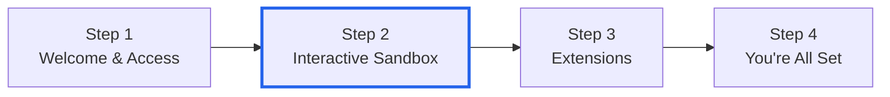

# OpenClip Onboarding Redesign — v2

> [!NOTE]
> Current onboarding: [OnboardingView.swift](file:///Users/ganesh/dev/openclip/Sources/OpenClip/UI/Onboarding/OnboardingView.swift), [OnboardingWindowController.swift](file:///Users/ganesh/dev/openclip/Sources/OpenClip/UI/Onboarding/OnboardingWindowController.swift), [RecommendedExtensionsView.swift](file:///Users/ganesh/dev/openclip/Sources/OpenClip/UI/Onboarding/RecommendedExtensionsView.swift)

---

## Flow Overview



---

## Step 1 — Welcome & Grant Accessibility

**Goal:** Introduce value + remove the permission barrier before the sandbox.

### Layout
- **Hero**: Large app icon (80pt), `"OpenClip"` (`.title.bold()`), tagline: *"Turn selected text into instant actions."*
- **Visual how-it-works strip** — three inline items with SF Symbols:
  1. `textformat.abc` — *Select text anywhere*
  2. `rectangle.badge.plus` — *An action bar appears*
  3. `bolt.fill` — *Translate, search, calculate & more*
- **Permission card** (lower half):
  - Icon: `hand.raised.fill` (secondary → green on grant)
  - Title: **"Accessibility Access"**
  - Copy: *"Needed to detect text you select in any app and place the action bar by your cursor."*
  - **"Grant Access"** button (`.borderedProminent`, `.controlSize(.large)`) → opens System Settings at `Privacy_Accessibility`
  - Live 0.5s polling via existing [`PermissionManager.startMonitoring()`](file:///Users/ganesh/dev/openclip/Sources/OpenClip/Platform/PermissionManager.swift#L27-L35)
  - **On grant**: Smooth spring transition to green **"✓ Access Granted"** badge
  - If already granted (re-run / prior install): auto-show green badge

### Footer
- **"Continue →"** always available (skip path; sandbox shows fallback if permission missing)

---

## Step 2 — Interactive Sandbox ★

**Goal:** Deliver the "Aha!" moment. The user physically experiences the floating popup and discovers that **different text = different actions**.

### The Sample Text

A single natural paragraph containing **four trigger zones**:

> **"Our next meeting is Friday at 2pm — the project budget is 1250 + 340. Check https://openclip.app for details."**

| What the user selects | Contextual actions that appear | The "wow" |
|---|---|---|
| `Friday at 2pm` | 🔍 Search, Copy, Cut, Paste, 📅 **Add Event** | A calendar icon appears! |
| `1250 + 340` | 🔍 Search, Copy, Cut, Paste, = **Calculate** | Tap it → instant `1590` |
| `https://openclip.app` | 🔍 Search, Copy, Cut, Paste, 🔗 **Open Link** | One-click open in browser |
| `meeting` (single word) | 🔍 Search, Copy, Cut, Paste, 📖 **Define** | Dictionary definition |
| Any other phrase | 🔍 Search, Copy, Cut, Paste | The reliable basics |

### Layout

```
┌─────────────────────────────────────────────────┐
│                                                 │
│  ⚡ Try It Right Now                            │
│  Select any text in the box below               │
│                                                 │
│  ┌───────────────────────────────────────────┐  │
│  │                                           │  │
│  │  Our next meeting is Friday at 2pm —      │  │
│  │  the project budget is 1250 + 340.        │  │
│  │  Check https://openclip.app for details.  │  │
│  │                                           │  │
│  └───────────────────────────────────────────┘  │
│                                                 │
│  ✅ Nice! Different text → different actions.   │
│                                                 │
│  ┌───────────────────────────────────────────┐  │
│  │  💡 Try selecting different parts:        │  │
│  │                                           │  │
│  │  📅  "Friday at 2pm"  → Add Event         │  │
│  │  =   "1250 + 340"     → Calculate         │  │
│  │  🔗  The URL           → Open Link         │  │
│  │  📖  A single word     → Define            │  │
│  └───────────────────────────────────────────┘  │
│                                                 │
└─────────────────────────────────────────────────┘
```

### Components

1. **Heading**: `"Try It Right Now"` (`.title2.bold()`)
2. **Subheading**: `"Select any text in the box below"` (`.subheadline`, `.secondary`)
3. **Interactive text area**: An `NSTextView` wrapped in `NSViewRepresentable`
   - Styled with a subtle background card (`Color.primary.opacity(0.04)`, 12pt corners)
   - Rich, readable text at 14pt system font
   - Fully selectable — native macOS text selection
4. **Success indicator** (appears after first selection detected):
   - Green checkmark: **"Nice! Different text → different actions."**
   - `.transition(.move(edge: .bottom).combined(with: .opacity))` with spring animation
   - Only appears once per sandbox visit, doesn't spam on every selection
5. **Discovery hints card** (always visible, below the text area):
   - Subtle background card listing the four trigger zones with their icons
   - Gives the user a reason to try selecting different parts
   - Light visual style — informational, not instructional

### How It Works Technically

- The `NSTextView` is a real native text view inside the onboarding window
- [`MacSelectionMonitor`](file:///Users/ganesh/dev/openclip/Sources/OpenClip/AppDelegate.swift#L92) runs process-wide — selecting text in this view triggers the same `onSelection` callback that works in any app
- The **real floating popup bar** appears near the cursor — same popup the user will use daily
- All actions work live: Calculate evaluates, Open Link opens the browser, etc.
- The onboarding window uses the existing [`KeyableWindow`](file:///Users/ganesh/dev/openclip/Sources/OpenClip/UI/Onboarding/OnboardingWindowController.swift#L14-L17) (borderless, `canBecomeKey`)

### Edge Cases

| Situation | Handling |
|---|---|
| Accessibility not granted (skipped Step 1) | Inline banner above text area: *"Enable Accessibility to try live selection."* + **"Grant Access"** button. "Continue →" still available. |
| Popup auto-dismisses on distance | Widen the distance threshold or suspend distance-dismissal while onboarding is visible (flag on `PopupWindowController`). |
| User clicks an action that opens a URL | Normal behavior — browser opens. Popup dismisses as usual. User returns to onboarding window. |
| Calculate result delivery | The result card or paste behavior works normally. The text `1590` appearing is the payoff. |

---

## Step 3 — Recommended Extensions

**Goal:** Power up the popup with 1-click curated extensions.

### Layout
- **Heading**: `"Supercharge Your Actions"` (`.title2.bold()`)
- **Subheading**: *"Install extensions to add more actions to your popup"* (`.subheadline`, `.secondary`)
- **Extension list**: Reuse existing [`RecommendedExtensionsView`](file:///Users/ganesh/dev/openclip/Sources/OpenClip/UI/Onboarding/RecommendedExtensionsView.swift)
  - 6 curated picks: Quick Translate, Word Count, Speak Selection, Obsidian Capture, Apple Reminders, GitHub Search
  - Install / Installed ✓ / Remove buttons with live progress
  - "Install File…" for advanced users
  - Dynamic installed count badge
- **Minor visual refresh**: Slightly larger icons (40pt vs 34pt), subtle installed-state highlight

---

## Step 4 — You're All Set

**Goal:** Reinforce what they learned and send them off.

### Layout
- **Hero**: `checkmark.seal.fill` icon (green, 48pt), `"You're All Set!"` (`.title.bold()`)
- **Quick Reference Card** (rounded subtle background):

  | What | How |
  |---|---|
  | Open Actions | Select text in any app |
  | Open Preferences | Menu bar icon → Preferences |
  | Global Shortcut | `⌥⌘C` to trigger the popup anytime |

- **Menu bar note**: *"OpenClip lives in your menu bar"* with `menubar.arrow.up.rectangle` icon
- **"Get Started"** button (`.borderedProminent`, `.controlSize(.large)`)
  - Sets `hasCompletedOnboarding = true`
  - Starts selection monitoring
  - Shows post-onboarding coach mark

---

## Window & Navigation

| Property | Value |
|---|---|
| Window size | **560 × 680** (wider + taller for sandbox text area + hints) |
| Style | Same borderless `KeyableWindow`, transparent bg, solid rounded card with border + shadow |
| Corner radius | 20pt continuous |
| Transitions | `.push(from: .trailing/.leading)` with `.easeInOut(duration: 0.3)` |
| Step indicator | 4 dots top-right + `"Step N of 4"` label |
| Close button | `xmark.circle.fill` top-right (skips to completion) |
| Keyboard | `Return` / `→` advances, `←` goes back, `Esc` closes |

---

## ⌥⌘C Accuracy Fix

The hotkey's actual behavior (from [`HotkeyManager.swift`](file:///Users/ganesh/dev/openclip/Sources/OpenClip/Platform/HotkeyManager.swift#L31-L104)):
- **Popup not visible** → retrieves selection/clipboard → shows the **action bar**
- **Popup visible** → `toggleMode()` → **dismisses** the popup

It does **not** open a search palette. Step 4's cheat sheet describes it correctly as *"trigger the popup anytime"*. The README's claim that `⌥⌘C` opens a "fuzzy search palette" should be corrected separately.

---

## Files to Create/Modify

| File | Action |
|---|---|
| [`OnboardingView.swift`](file:///Users/ganesh/dev/openclip/Sources/OpenClip/UI/Onboarding/OnboardingView.swift) | **Rewrite** — 4-step flow with sandbox |
| [`OnboardingWindowController.swift`](file:///Users/ganesh/dev/openclip/Sources/OpenClip/UI/Onboarding/OnboardingWindowController.swift) | **Update** — window size 560×680 |
| [`RecommendedExtensionsView.swift`](file:///Users/ganesh/dev/openclip/Sources/OpenClip/UI/Onboarding/RecommendedExtensionsView.swift) | **Keep** — minor icon size tweak |
| New: `SandboxTextView.swift` | **Create** — `NSViewRepresentable` wrapping `NSTextView` |
| [`OnboardingWindowControllerTests.swift`](file:///Users/ganesh/dev/openclip/Tests/OpenClipTests/OnboardingWindowControllerTests.swift) | **Update** — 4-step enum |
